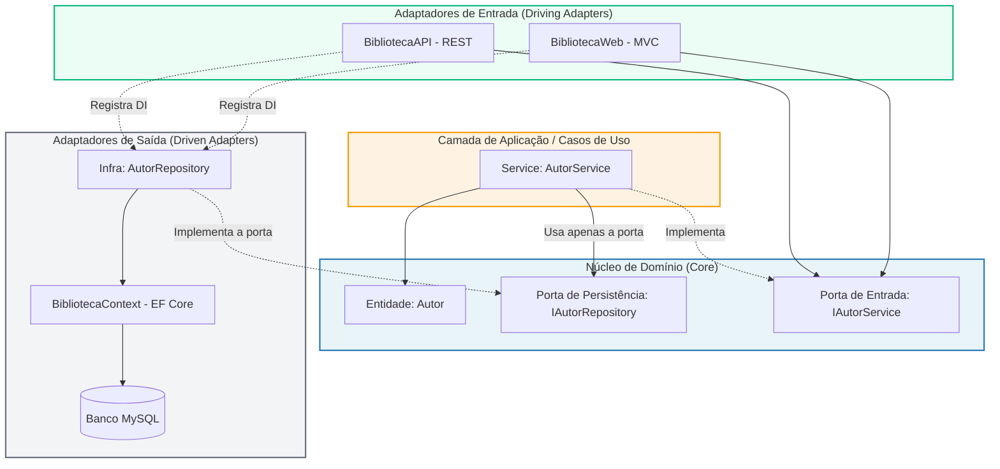

# Atividade 01: Adaptação Arquitetural — Fatia Vertical do Agregado Autor

> **Disciplina:** Tópicos Especiais em Engenharia de Software (TEES)  
> **Objetivo:** Aplicar a Regra de Dependência de arquiteturas limpas (Clean / Hexagonal Architecture) sobre um sistema existente, fazendo com que o domínio pare de depender diretamente do banco de dados na fatia vertical do agregado **Autor**.

---

## Sumário
1. [Diagnóstico da Arquitetura Inicial](#1-diagnóstico-da-arquitetura-inicial)
   - [1.1 Visão Externa (Encontro 01)](#11-visão-externa-encontro-01)
   - [1.2 Visão Interna (Encontro 02)](#12-visão-interna-encontro-02)
   - [1.3 Onde a Regra de Dependência Não se Aplicava](#13-onde-a-regra-de-dependência-não-se-aplicava)
2. [Escolha da Arquitetura e Justificativa](#2-escolha-da-arquitetura-e-justificativa)
   - [2.1 Arquitetura Escolhida](#21-arquitetura-escolhida)
   - [2.2 Justificativa Técnica](#22-justificativa-técnica)
3. [Implementação: Portas e Adaptadores (Fatia Vertical Autor)](#3-implementação-portas-e-adaptadores-fatia-vertical-autor)
   - [3.1 Porta de Persistência no Domínio (`Core`)](#31-porta-de-persistência-no-domínio-core)
   - [3.2 Adaptador com Entity Framework Fora do Domínio (`Infra`)](#32-adaptador-com-entity-framework-fora-do-domínio-infra)
   - [3.3 Refatoração do Serviço de Aplicação/Domínio (`Service`)](#33-refatoração-do-serviço-de-aplicaçãodomínio-service)
   - [3.4 Injeção de Dependências nos Hosts de Entrada](#34-injeção-de-dependências-nos-hosts-de-entrada)
4. [Mapeamento das Alterações e Distribuição de Responsabilidades](#4-mapeamento-das-alterações-e-distribuição-de-responsabilidades)
   - [4.1 Comparativo Antes vs Depois](#41-comparativo-antes-vs-depois)
   - [4.2 Diagrama das Dependências (Direção dos Fluxos)](#42-diagrama-das-dependências-direção-dos-fluxos)
5. [Validação e Testes Automatizados](#5-validação-e-testes-automatizados)
   - [5.1 Isolamento da Regra de Negócio com Mocks](#51-isolamento-da-regra-de-negócio-com-mocks)
   - [5.2 Como Executar os Testes](#52-como-executar-os-testes)
   - [5.3 Resultado dos Testes](#53-resultado-dos-testes)

---

## 1. Diagnóstico da Arquitetura Inicial

### 1.1 Visão Externa (Encontro 01)
- **Classificação:** **Monolito (não-modular)**.
- **Artefatos e Bancos:** A solução possui dois pontos de entrada / artefatos frontais:
  - `BibliotecaWeb`: Aplicação ASP.NET Core MVC renderizada no servidor.
  - `BibliotecaAPI`: API RESTful em ASP.NET Core Web API.
- Ambos os artefatos compartilham o mesmo projeto de serviços (`Service`), o mesmo núcleo de entidades e contexto (`Core`) e apontam para **um único banco de dados relacional compartilhado** (MySQL via Entity Framework Core).

```
+------------------+       +------------------+
|  BibliotecaWeb   |       |  BibliotecaAPI   |
+--------+---------+       +--------+---------+
         |                          |
         +------------+-------------+
                      v
             +-----------------+
             |     Service     |
             +--------+--------+
                      v
             +-----------------+
             |    Core + EF    |
             +--------+--------+
                      v
             [ Banco MySQL EF ]
```

### 1.2 Visão Interna (Encontro 02)
- **Classificação:** **Arquitetura em Camadas Clássica (N-Tier / Layered Architecture)**.
- O fluxo de chamada seguia estritamente de cima para baixo:
  $$\text{Controller} \longrightarrow \text{Service} \longrightarrow \text{Core + Entity Framework}$$
- Embora `Core` já contivesse as interfaces de serviço (como `IAutorService`), não existia uma camada ou abstração de repositório para o acesso a dados.

### 1.3 Onde a Regra de Dependência Não se Aplicava
A Regra de Dependência (fundamental na *Clean Architecture*, *Hexagonal* e *Onion*) estabelece que:
> *O código-fonte de camadas internas (regras de negócio e domínio) não pode saber nada sobre detalhes técnicos de camadas externas (banco de dados, UI, frameworks, ORMs).*

Na arquitetura inicial, a regra era violada em dois pontos críticos:

1. **Acoplamento do Domínio (`Core`) ao ORM e Banco:**
   - O projeto `Core.csproj` referenciava diretamente os pacotes de banco de dados:
     - `Microsoft.EntityFrameworkCore`
     - `MySql.EntityFrameworkCore`
     - `Microsoft.AspNetCore.Identity.EntityFrameworkCore`
   - A classe concreta de conexão e mapeamento `BibliotecaContext` residia dentro de `Core`, acoplando o domínio ao Entity Framework.

2. **Dependência Direta do Serviço no Entity Framework:**
   - O serviço `AutorService` recebia diretamente a classe concreta `BibliotecaContext` por injeção de dependência:
     ```csharp
     // Service/AutorService.cs - Estado Anterior
     public class AutorService : IAutorService
     {
         private readonly BibliotecaContext context; // Acoplamento direto com EF

         public AutorService(BibliotecaContext context)
         {
             this.context = context;
         }
         // Consultas LINQ/EF espalhadas pelo serviço de negócio
     }
     ```
3. **Impacto na Testabilidade das Regras de Negócio:**
   - Para testar regras de negócio simples em `AutorServiceTests` (como validar se a data de nascimento é válida), era obrigatório subir um banco em memória (`builder.UseInMemoryDatabase("Biblioteca")`), pois o serviço não permitia mockar a persistência.

---

## 2. Escolha da Arquitetura e Justificativa

### 2.1 Arquitetura Escolhida
Foi adotada a **Clean Architecture (Arquitetura Limpa)** combinada com o estilo **Portas e Adaptadores (Arquitetura Hexagonal de Alistair Cockburn)**.

### 2.2 Justificativa Técnica
A escolha fundamenta-se nos seguintes princípios de engenharia de software:

1. **Aplicação do Princípio da Inversão de Dependência (DIP - SOLID):**
   - Módulos de alto nível (regras de negócio em `AutorService` e entidades em `Core`) não devem depender de módulos de baixo nível (Entity Framework / MySQL). Ambos passam a depender de abstrações (`IAutorRepository`).
2. **Isolamento e Estabilidade do Núcleo de Domínio:**
   - O domínio e as regras de negócio tornam-se agnósticos ao mecanismo de persistência. Se no futuro for necessário substituir o Entity Framework, nenhuma linha do domínio ou de regras de negócio precisa ser alterada.
3. **Testabilidade Pura e Rápida:**
   - Regras de negócio podem ser testadas utilizando *mocks* ou *stubs* da porta `IAutorRepository`, sem a necessidade de instanciar contexto de banco de dados ou banco em memória.
4. **Alinhamento com a Fatia Vertical:**
   - O modelo de portas e adaptadores permitiu migrar a fatia vertical de **Autor** de ponta a ponta com segurança e precisão, mantendo a integridade do restante do sistema.

---

## 3. Implementação: Portas e Adaptadores (Fatia Vertical Autor)

### 3.1 Porta de Persistência no Domínio (`Core`)
Foi declarada a interface de repositório no projeto `Core`, definindo o contrato exigido pelo domínio para gerenciar o agregado `Autor`, sem nenhuma dependência de infraestrutura externa:

- **Arquivo:** `Core/Repository/IAutorRepository.cs`
- **Namespace:** `Core.Repository`

```csharp
namespace Core.Repository
{
    public interface IAutorRepository
    {
        uint Insert(Autor autor);
        void Update(Autor autor);
        void Delete(uint id);
        Autor? Get(uint id);
        IEnumerable<Autor> GetAll();
        IEnumerable<Autor> GetAllOrderByNome();
        int GetCountAutores();
        IEnumerable<Autor> GetByName(string nomeAutor);
        IEnumerable<Autor> GetOrderByDescending();
        IEnumerable<AutorDto> GetByNome(string nome);
        DatatableResponse<Autor> GetDataPage(DatatableRequest request);
    }
}
```

### 3.2 Adaptador com Entity Framework Fora do Domínio (`Infra`)
Foi criado um novo projeto de biblioteca de classes (`Infra`) para abrigar a infraestrutura de dados e os adaptadores de persistência.

- **Projeto:** `Infra/Infra.csproj` (referencia `Core.csproj` e o Entity Framework).
- **Adaptador:** `Infra/Repository/AutorRepository.cs`
- **Namespace:** `Infra.Repository`

A classe `AutorRepository` implementa `IAutorRepository` e encapsula todas as consultas e operações do Entity Framework Core (`BibliotecaContext`), impedindo que detalhes de SQL, LINQ to Entities ou tracking vazem para as camadas superiores.

### 3.3 Refatoração do Serviço de Aplicação/Domínio (`Service`)
O `AutorService` foi refatorado para:
- Remover a dependência de `BibliotecaContext` e o namespace `Microsoft.EntityFrameworkCore`.
- Injetar exclusivamente a abstração `IAutorRepository`.
- Executar as validações de regra de negócio (ex: ano de nascimento $\ge 1000$) e delegar as operações de persistência para o repositório.

```csharp
// Service/AutorService.cs - Refatorado
public class AutorService : IAutorService
{
    private readonly IAutorRepository autorRepository;

    public AutorService(IAutorRepository autorRepository)
    {
        this.autorRepository = autorRepository;
    }

    public uint Create(Autor autor)
    {
        // Regra de negócio isolada
        if (autor.DataNascimento.Year < 1000)
            throw new ServiceException("O ano de nascimento de autor deve ser maior do que 1000. Favor informar nova data.");

        return autorRepository.Insert(autor);
    }
    // ... demais operações delegadas à porta de persistência
}
```

> **Importante para a Regra de Dependência:**  
> O projeto `Service.csproj` **NÃO referencia o projeto `Infra.csproj`**. Ele referencia apenas `Core.csproj`. O sentido da dependência aponta exclusivamente para dentro!

### 3.4 Injeção de Dependências nos Hosts de Entrada
A amarração entre a porta (`IAutorRepository`) e o adaptador concreto (`AutorRepository`) é feita exclusivamente no momento da composição da aplicação (*Composition Root*), nos arquivos `Program.cs` dos projetos executáveis:

- **`BibliotecaWeb/Program.cs`**:
  ```csharp
  builder.Services.AddTransient<IAutorRepository, AutorRepository>();
  builder.Services.AddTransient<IAutorService, AutorService>();
  ```
- **`BibliotecaAPI/Program.cs`**:
  ```csharp
  builder.Services.AddTransient<IAutorRepository, AutorRepository>();
  builder.Services.AddTransient<IAutorService, AutorService>();
  ```

Ambos os projetos referenciam `Core`, `Service` e `Infra` apenas para fins de configuração da injeção de dependência.

---

## 4. Mapeamento das Alterações e Distribuição de Responsabilidades

### 4.1 Comparativo Antes vs Depois

| Componente | Antes da Migração | Depois da Migração (Clean/Hexagonal) |
| :--- | :--- | :--- |
| **`Core` (Domínio)** | Continha entidades, interfaces de serviço e o `BibliotecaContext` (EF Core acoplado). | Contém entidades puras, DTOs e a **Porta de Persistência** (`IAutorRepository`). |
| **`Service` (Aplicação)** | Injetava `BibliotecaContext` diretamente; misturava regra de negócio e comandos EF. | Depende apenas da interface `IAutorRepository`; regra de negócio 100% pura e isolada. |
| **`Infra` (Adaptadores)** | Inexistente. | Novo projeto que implementa o **Adaptador de Persistência** (`AutorRepository`) com EF Core. |
| **Sentido das Dependências** | `Service` dependia diretamente do EF / banco de dados. | `Infra` $\to$ depende de $\to$ `Core`. `Service` $\to$ depende de $\to$ `Core`. Dependências invertidas e apontando para o centro. |
| **Testabilidade** | Exigia `UseInMemoryDatabase` do EF para testar qualquer método de serviço. | Permite testes unitários puros com `Moq` sem carregar contexto de banco. |

### 4.2 Diagrama das Dependências (Direção dos Fluxos)

Abaixo, o diagrama demonstra como a regra de dependência e a inversão de controle foram estabelecidas:



---

## 5. Validação e Testes Automatizados

### 5.1 Isolamento da Regra de Negócio com Mocks
Com o desacoplamento implementado, foram criados testes unitários puros utilizando a biblioteca `Moq` em `ServiceTests/AutorServiceTests.cs`. Esses testes comprovam que:
1. Quando a regra de negócio é violada (ano de nascimento $< 1000$), a exceção `ServiceException` é lançada imediatamente e o repositório **nunca é chamado** (`mockRepo.Verify(..., Times.Never)`).
2. Para cenários válidos, o teste valida o retorno e garante que a porta foi acionada exatamente uma vez (`Times.Once`), sem necessidade de inicializar DbContext ou banco em memória.

### 5.2 Como Executar os Testes
Para rodar toda a suíte de testes de unidade e integração:

```bash
cd exercicio-1-arquitetura/Biblioteca
dotnet test
```

### 5.3 Resultado dos Testes
- **`ServiceTests`**: 9 testes aprovados (6 testes originais adaptados para a nova arquitetura + 3 novos testes com mock comprovando isolamento).
- **`BibliotecaWebTests`**: 9 testes de controller aprovados.
- **Total:** **18 testes executados com 100% de sucesso e 0 falhas.**
- Ou seja, mudamos a arquitetura da entidade autor, e mantivemos todos os testes aprovados.
