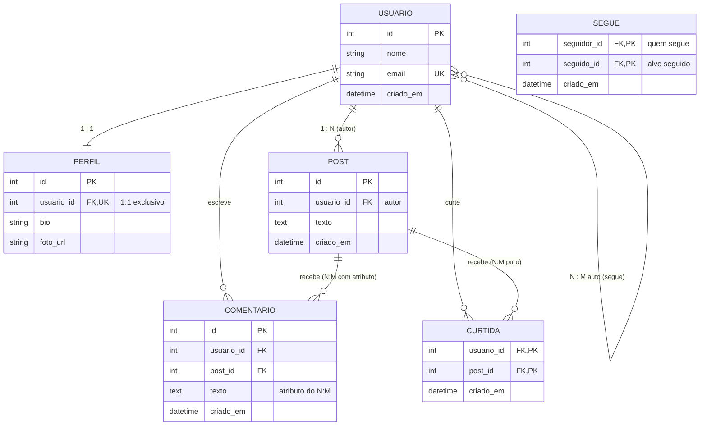

# Atividade 02 - protocolos - Tópicos Especiais em Engenharia de Software


## Enunciado da atividade

Escolher dois protocolos entre REST, SOAP, GraphQL, gRPC e WebSockets, e expor o mesmo domínio nos dois. Pode ser em dois projetos separados, um para cada protocolo, ou num único projeto que fala os dois, a escolha é sua. A linguagem de programação também é livre, e pode ser diferente entre os dois protocolos.


| Protocolo | Formato | Modelo |
| --- | --- | --- |
| SOAP | XML | Requisição/resposta |
| **REST** | JSON | Requisição/resposta |
| **GraphQL** | JSON | Consulta declarativa |
| gRPC | Binário | Chamada de procedimento |
| WebSockets | Livre | Canal permanente |


### O Domínio: Rede Social

| Comandos | Consultas |
| --- | --- |
| criar_usuario(nome, email) | buscar_usuario(id) |
| criar_post(usuario_id, texto) | posts_do_usuario(usuario_id) |
| comentar(usuario_id, post_id, texto) | buscar_post(id) |
| curtir(usuario_id, post_id) | seguidores_de(id) / seguindo_de(id) |
| seguir(usuario_id, alvo_id) | feed_do_usuario(usuario_id) |

Os cinco comandos e as cinco consultas são obrigatórios nos dois protocolos escolhidos.

#### Modelagem do Banco de Dados (ER)




### Requisitos

1. Os cinco comandos e as consultas buscar_usuario, posts_do_usuario, buscar_post e seguidores_de/seguindo_de, ou o equivalente no protocolo.
2. Exemplo de requisição e de resposta, copiável, para cada operação.
3. Instruções para executar, do zero.
4. Uma linha dizendo o que esse protocolo faz melhor que o outro escolhido, nesse domínio.


### Entrega

```bash
tees-2026-2-unidade-1/ 
└── exercicio-2-protocolos/ 
    ├── README.md visão geral + a comparação final 
    ├── <protocolo-a>/ README próprio 
    └── <protocolo-b>/ README próprio
```

Nome da pasta conforme o protocolo, por exemplo rest-json/, soap-xml/, graphql/, grpc/ ou websockets/. Essa é a estrutura para dois projetos separados, num projeto único adapte as pastas, mas mantenha os dois protocolos separados e identificáveis, e o README.md continua trazendo a comparação final.


## Protocolos Escolhidos

* **REST (JSON):** Arquitetura orientada a recursos sobre HTTP.
* **GraphQL (JSON):** Linguagem de consulta declarativa sobre HTTP.

---

## Como Executar do Zero

### 1. Criar e Ativar Ambiente Virtual
```bash
python3 -m venv .venv
source .venv/bin/activate
```

### 2. Instalar Dependências
```bash
pip install -r requirements.txt
```

### 3. Iniciar o Servidor
```bash
uvicorn main:app --reload --port 8000
```

* **Swagger UI (REST):** [http://localhost:8000/docs](http://localhost:8000/docs)
* **GraphiQL (GraphQL):** [http://localhost:8000/graphql](http://localhost:8000/graphql)

### 4. Scripts Auxiliares
* **Popular o banco com dados de exemplo:**
  ```bash
  python seed.py
  ```
* **Resetar o banco (apagar tudo e recriar vazio):**
  ```bash
  python seed.py --reset
  ```
* **Executar suíte de testes dos 5 comandos e 5 consultas:**
  ```bash
  python test_protocols.py
  ```

---

## Comparação Final

> **O que o REST faz melhor que o GraphQL neste domínio:**  
> O REST oferece simplicidade arquitetural máxima, padronização universal com verbos HTTP e se beneficia nativamente do ecossistema de **cache HTTP na borda** para recursos que mudam pouco (como fotos de perfil e dados cadastrais), sem necessidade de interpretar parsers de consultas.

> **O que o GraphQL faz melhor que o REST neste domínio:**  
> O GraphQL permite que o cliente declare em **uma única requisição** exatamente a árvore de dados relacional necessária (ex: post, autor, contagem de curtidas e comentários com seus respectivos autores), **eliminando completamente o problema de under-fetching (N+1 roundtrips) e o over-fetching** de dados no feed da rede social.

---

## Documentação Específica dos Protocolos

Para os exemplos copiáveis de requisição e resposta de cada operação:
* 📄 [Documentação do Protocolo REST](protocolo-rest/README.md)
* 📄 [Documentação do Protocolo GraphQL](protocolo-graphql/README.md)


